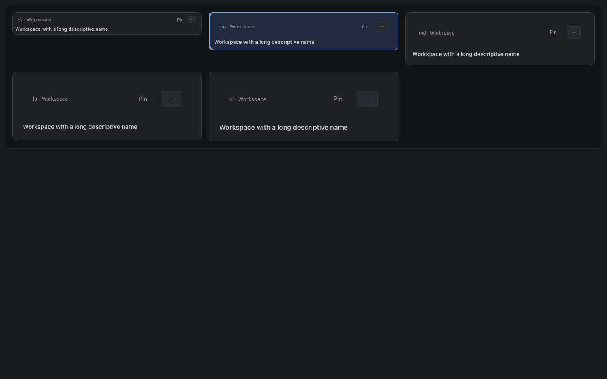
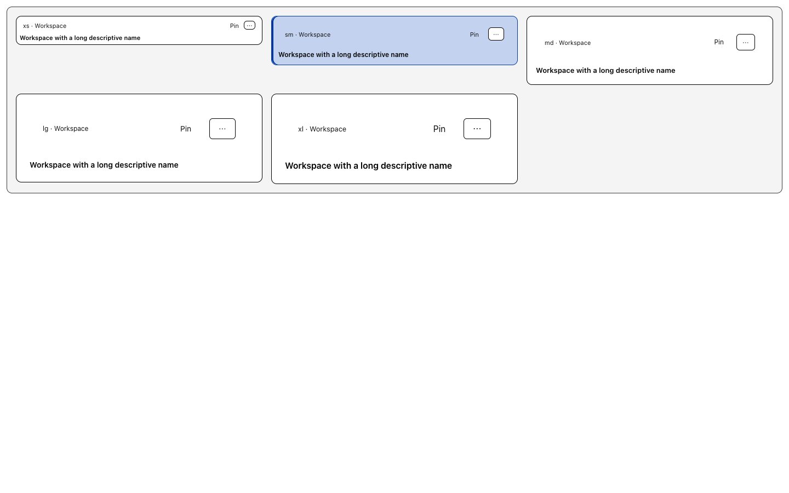
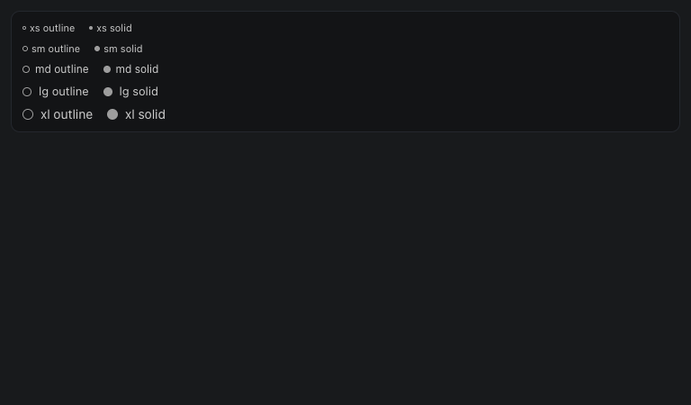
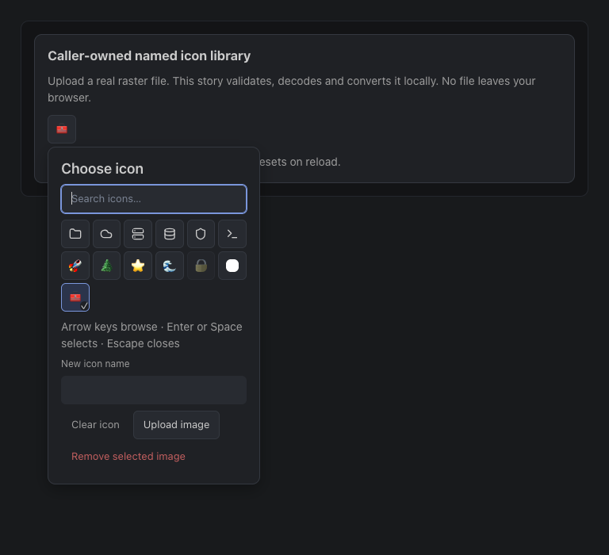
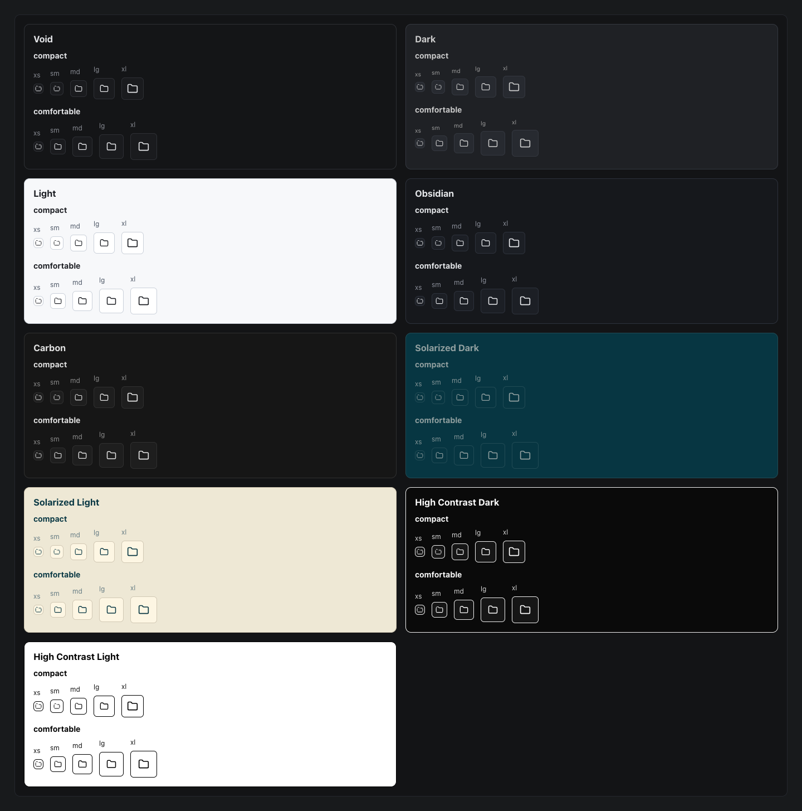

# Cluster explorer composition fixes

These captures show the actual Base UI Storybook components, not a redrawn mock. The Kubernetes consumer and its real local API verification are tracked in [kubernetes#224](https://github.com/omniviewdev/omniview-plugin-kubernetes/issues/224).

## Shared contracts

- `Card.Action placement="inline"` reserves space in a caller-owned header layout. Existing corner placement remains the default. Primary navigation, pinning and the Settings menu were exercised independently.
- `StatusDot variant="outline"` keeps the solid variant's outer dimensions and semantic color. It does not imply workload health.
- `IconPicker uploadFields` places caller-owned upload metadata inside the popup, not beside the icon-only trigger. File validation, naming and persistence remain caller-owned.
- Palette cells retain a square aspect ratio when larger sizes meet a narrow viewport. Six-column keyboard navigation remains unchanged.
- Keyed-search suggestion descriptions align at the trailing edge. Decorative submenu carets no longer enter accessible names.

## Visual verification

All nine built-in themes were exercised: Void, Dark, Light, Obsidian, Carbon, Solarized Dark, Solarized Light, High Contrast Dark and High Contrast Light.

| Surface                     | Exercised combinations                                         | Result                                                                                 |
| --------------------------- | -------------------------------------------------------------- | -------------------------------------------------------------------------------------- |
| In-flow Card actions        | 9 themes × 2 densities × 5 component sizes × 4 viewport widths | 360 component cases; names retain usable width; actions remain inside their cards      |
| Solid and outline StatusDot | 9 themes × 2 densities × 5 sizes × 2 variants                  | 180 rendered dots; equal outer geometry and matching semantic colors                   |
| Icon-only triggers          | 9 themes × 2 densities × 5 sizes × 4 viewport widths           | 360 square triggers inside the viewport                                                |
| Open icon palettes          | 9 themes × 2 densities × 5 sizes at 360px                      | 90 popups; square cells, autofocus, bounded geometry and retained caller theme/density |

Viewport widths: 360, 768, 1063 and 1568 CSS pixels. Card screenshots use 1440 × 900 CSS pixels. The JSON files alongside these images contain the measured cases.

Normal Card transitions measured 160ms; explicit reduced motion suppressed both card and rail transitions. Nested Light inside Dark and custom success-derived card aliases were also exercised. A real raster image was decoded, uploaded into the story's local library, searched and selected. The selected trigger remained an icon-only square.

## Captures

[Actual selection animation recording](card-selection.webm)

[Before narrow XL palette](before-icon-palette-xl-narrow.png) · [After square cells](after-icon-palette-xl-narrow.png)

Additional `inline-actions-*.png` captures cover every native theme. `nested-custom-card-aliases.png` covers nested and custom semantic aliases.

## Checks and limits

The affected shared component suites passed 106 tests. The production Base UI bundle and portable declarations built successfully. Native TypeScript and scoped ESLint checks passed.

Story libraries are local examples, not backend persistence tests. Browser captures do not prove native OS window or file/color-dialog rendering. The Kubernetes PR supplies the separate real-app organization and persistence evidence.
