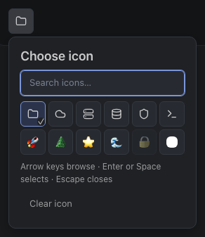
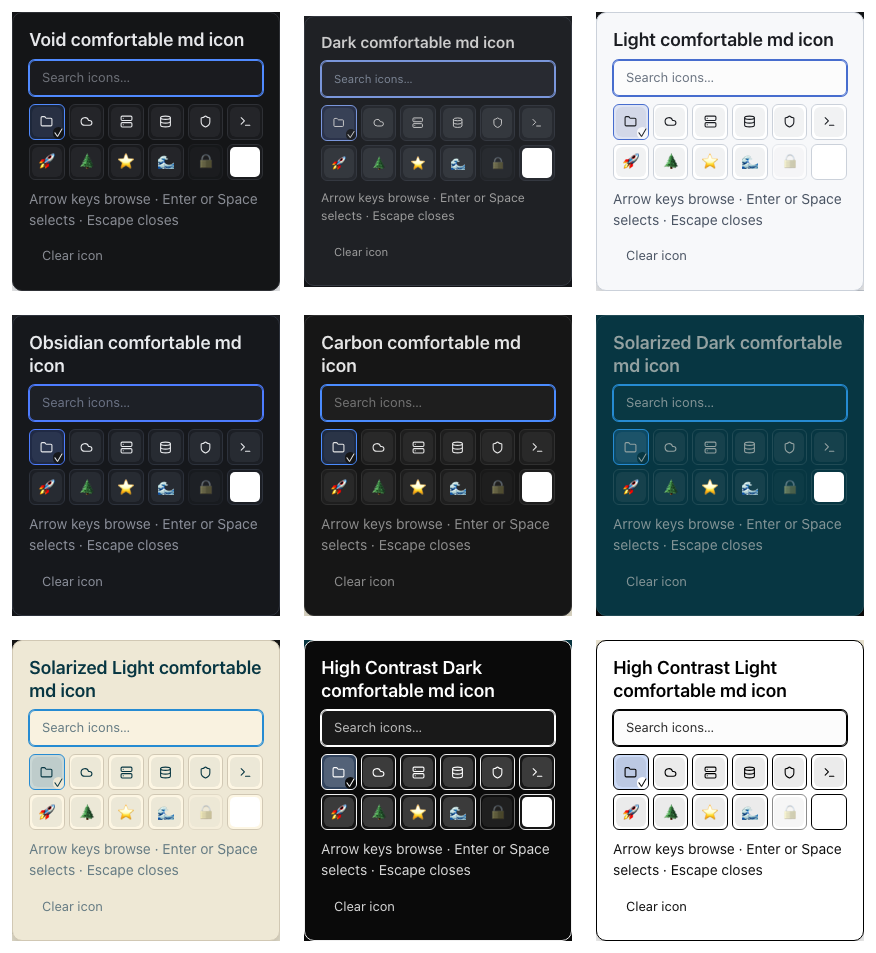

# IconPicker acceptance evidence

Reusable component acceptance passed. Kubernetes application integration and release sequencing remain tracked on the [cluster explorer board](https://github.com/orgs/omniviewdev/projects/14) and [UI issue #102](https://github.com/omniviewdev/ui/issues/102).

## Verified

- Base UI suite: 1,765 tests across 152 files passed, including Safari composition and partial-grid keyboard navigation regressions.
- Base UI TypeScript check and changed-component ESLint passed.
- All nine native themes, five component sizes, and both densities: 90 picker combinations.
- Icon-only square triggers with centered artwork and no visible label or chevron in every combination.
- Search autofocus, arrow navigation, Enter selection, and scoped popup geometry in every combination.
- Text scales 80, 90, 100, 110, and 125 in narrow dark/light panes.
- Every size tier at 360px width and 125% text, in both densities.
- Nested dark/light scopes, custom semantic token overrides, and reduced motion.
- Real PNG upload, decode, normalization, named selection, removal, and explicit SVG rejection through the caller-owned library story.
- Zero browser errors in the portable acceptance run.

The same run also checked the previously merged Card and KeyedSearch surfaces. Its 198 records contain 18 five-size Card groups, 90 KeyedSearch combinations, and 90 IconPicker combinations. Additional narrow and upload scenarios appear under `interactions` in [verification.json](evidence/cluster-icon-picker/verification.json).

Picker chrome uses existing semantic tokens. Uploaded artwork retains its original colors. The local popup portal preserves nested theme scopes; custom token coverage does not depend on a particular built-in palette.

## Screenshots





- [All native theme, density, and size triggers](evidence/cluster-icon-picker/icons-native-theme-size-matrix.png)
- [360px, XL, 125%, high-contrast light](evidence/cluster-icon-picker/icons-narrow-xl-125.png)
- [Named raster library](evidence/cluster-icon-picker/icons-upload-library.png)
- [Nested custom token scope and reduced motion](evidence/cluster-icon-picker/icons-nested-custom-reduced-motion.png)

## Reproduce

From `packages/base-ui`, start its component-specific Storybook preview; the root preview does not expose the text-size control:

```sh
node ../../node_modules/storybook/dist/bin/dispatcher.js dev --port 6022 --host 127.0.0.1 --ci --no-open --no-version-updates --disable-telemetry --exact-port
```

From the UI repository root:

```sh
node packages/benchmarks/scripts/verify-explorer-components.mjs http://127.0.0.1:6022 /tmp/omniview-explorer-components
node node_modules/@typescript/native/bin/tsc --noEmit --tsBuildInfoFile /tmp/omniview-base-ui-check.tsbuildinfo -p packages/base-ui/tsconfig.json
node node_modules/eslint/bin/eslint.js packages/base-ui/src/components/icon-picker packages/base-ui/src/components/index.ts packages/benchmarks/scripts/verify-explorer-components.mjs
```

From `packages/base-ui`:

```sh
node node_modules/vitest/vitest.mjs run --no-cache --configLoader runner
```

Managed workspaces own dependency caches. Stop standalone review servers before launching the application. A normal composite `tsc --noEmit` can still modify `node_modules/.tmp`; use an external `--tsBuildInfoFile`. If standalone tooling changes an owned dependency tree, use the supported stopped-workspace `workspace reset-modules` operation, not manual cache or ownership-journal edits.
