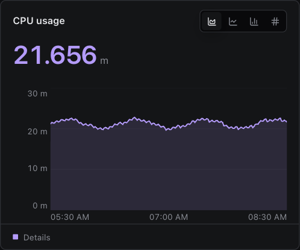
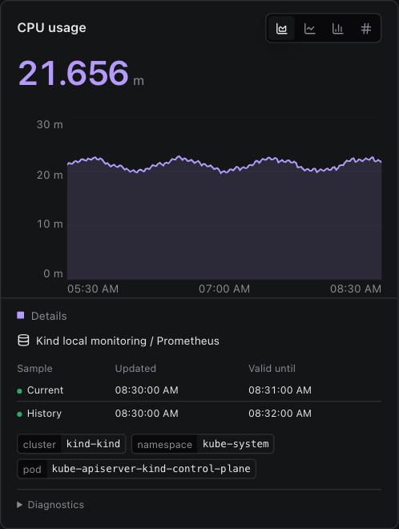

# Metrics component review

Phase one only: standalone base-ui components. No IDE integration, PR, merge, or publish.

## Live Storybook

- [Reference panel](http://127.0.0.1:48637/?path=/story/metrics-components-metricpanel--default&globals=theme:void;density:compact;motion:reduced)
- [Expanded details](http://127.0.0.1:48637/?path=/story/metrics-components-metricpanel--details-expanded&globals=theme:void;density:compact;motion:reduced)
- [Service](http://127.0.0.1:48637/?path=/story/metrics-compositions--service&globals=theme:void;density:compact;motion:reduced)
- [Cluster](http://127.0.0.1:48637/?path=/story/metrics-compositions--cluster&globals=theme:void;density:compact;motion:reduced)
- [Large data](http://127.0.0.1:48637/?path=/story/metrics-compositions--large-data&globals=theme:void;density:compact;motion:reduced)

## Screenshots

| Reference card                              | Structured details                                   |
| ------------------------------------------- | ---------------------------------------------------- |
|  |  |

[Pod](pod.png) · [Service](service.png) · [Cluster](cluster.png) · [Large data](large-data.png) · [Compact capacity](compact-capacity.png) · [Installed package](packed-consumer.png)

## Observed checks

| Check                                                                  | Result                                                                            |
| ---------------------------------------------------------------------- | --------------------------------------------------------------------------------- |
| Full base-ui suite                                                     | 159 files, 1,816 tests passed                                                     |
| Typecheck and scoped ESLint                                            | Passed                                                                            |
| Library build and tarball pack                                         | Passed                                                                            |
| Static Storybook build                                                 | Passed                                                                            |
| Public metrics-only consumer, strict TypeScript without `skipLibCheck` | Passed                                                                            |
| Installed tarball, Vite production build and browser render            | Passed                                                                            |
| Individual stories                                                     | 17 component entries, 67 stories; all defaults and variants rendered              |
| Theme geometry                                                         | All nine built-in themes: 398 × 332px reference card, 34px collapsed footer       |
| Shared Details                                                         | Pod, Pod Advanced, Service, Cluster, and Large Data use the same panel disclosure |
| Refresh                                                                | Same card and chart path; 332px card height and unchanged plot position           |
| Relative and absolute ranges                                           | Same card and chart path; Details remains open                                    |
| Keyboard                                                               | Enter opens and closes Details                                                    |
| Large-data table                                                       | 2,400 resources; 13 rendered table rows, not 2,400                                |
| Compact capacity                                                       | 120 × 24px cells inside 42px rows; unknown differs from zero                      |
| Browser errors                                                         | None observed in Storybook or installed-package smoke                             |

All sample data is deterministic fixture data. This evidence does not claim a live cluster or remote-device test.

### Strict root-entry probe: resolved

The earlier strict root-entry probe exposed React 19 JSX references in DnD's declarations. Both root and metrics entries now pass in a fresh installed consumer without `skipLibCheck`, workspace aliases, or consumer patches. The workspace patch imports React's JSX types locally; portable package declarations embed DnD's complete type graph.

See [clean development checks](./clean-development-checks.md) for the completed validation, build, tooling, and live browser evidence. Library builds no longer emit the prior editor warnings. Storybook and showcase builds pass with remaining upstream loader/chunk-size advisories; they are not zero-warning builds.
